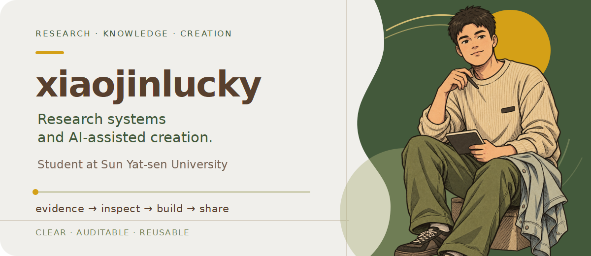

# xiaojinlucky

  

I am xiaojinlucky, a student at Sun Yat-sen University. I build auditable research workflows and AI-assisted systems that turn messy evidence into usable outputs.

## What I am building

- **Evidence-grounded research** — connecting papers, code, data, and reproducible analysis paths.
- **Knowledge systems** — organizing complex materials into traceable, reusable workflows.
- **AI-assisted creation** — turning research and accumulated knowledge into clear, reusable content workflows.

## My working loop

\`\`\`text
evidence  →  inspect  →  build  →  validate  →  ship
\`\`\`

I care about clear boundaries, traceable decisions, and workflows that can be reused after the first successful run.

  Research systems · knowledge workflows · AI-assisted creation

