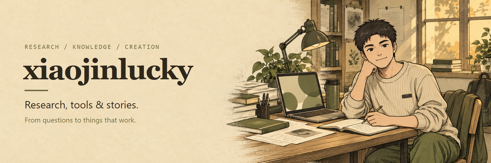
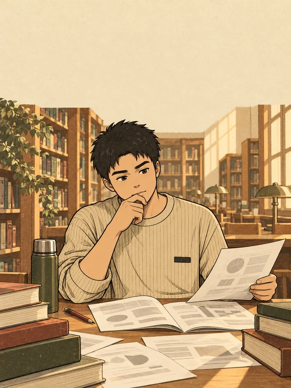
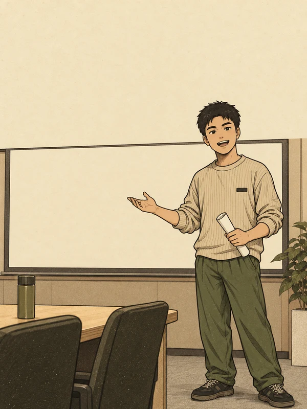
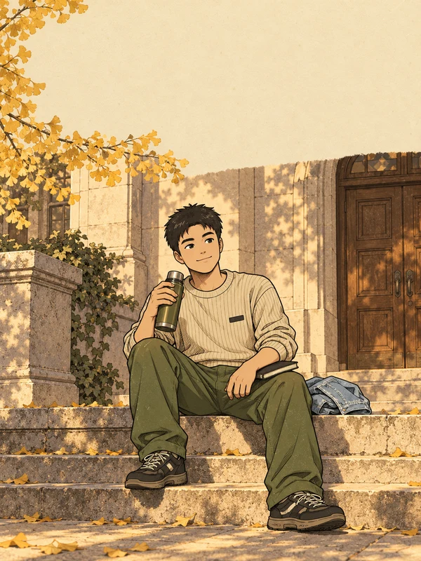

  

# Hi, I'm xiaojinlucky

中山大学在读。关注生物医学与生信研究，也把日常遇到的科研、知识整理和创作问题，做成可以反复使用的 AI 工作流。

I study at Sun Yat-sen University and build practical workflows for research, knowledge work, and AI-assisted creation.

**从问题出发，用证据判断，把工具用到真实工作里。**

## 可以从这里开始

| 项目 | 解决什么问题 | 适合谁 |
| --- | --- | --- |
| [科研思路 Skills](https://github.com/xiaojinlucky/skills) | 把科研卡点整理为明确的问题、证据缺口和下一步行动 | 生物医学与生信研究生 |
| [WorkBuddy Expert Bridge](https://github.com/xiaojinlucky/workbuddy-expert-bridge) | 在常用 AI 工具里发现并复用本机已有的 WorkBuddy 专家 | 希望复用成熟工作流的 Agent 用户 |

## 我在做的事

**科研与证据**

围绕具体科学问题，把文献、数据、分析和图表连起来。区分观察、推断与验证，让每一步都能追溯。

**工具与工作流**

先用成熟工具，再补真正缺少的部分。关注的终点是能在真实工作中使用的结果。

**知识与创作**

把积累的材料整理成清楚的文章、图解与可复用资产。也在持续完善「做科研的Meta师兄」的视觉表达。

## 同一个师兄，不同的工作现场

  
  
  

米色毛衣、橄榄绿裤子、一只保温杯。画面会换，人物和表达保持一致。

欢迎在对应项目的 Issues 里交流具体问题、使用体验和改进建议。
